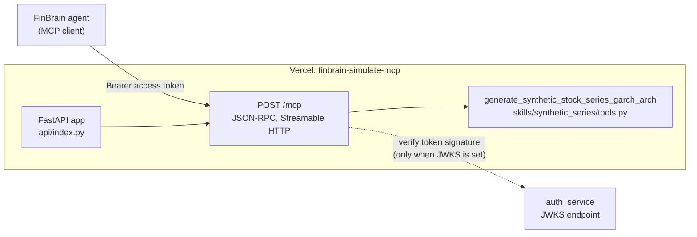
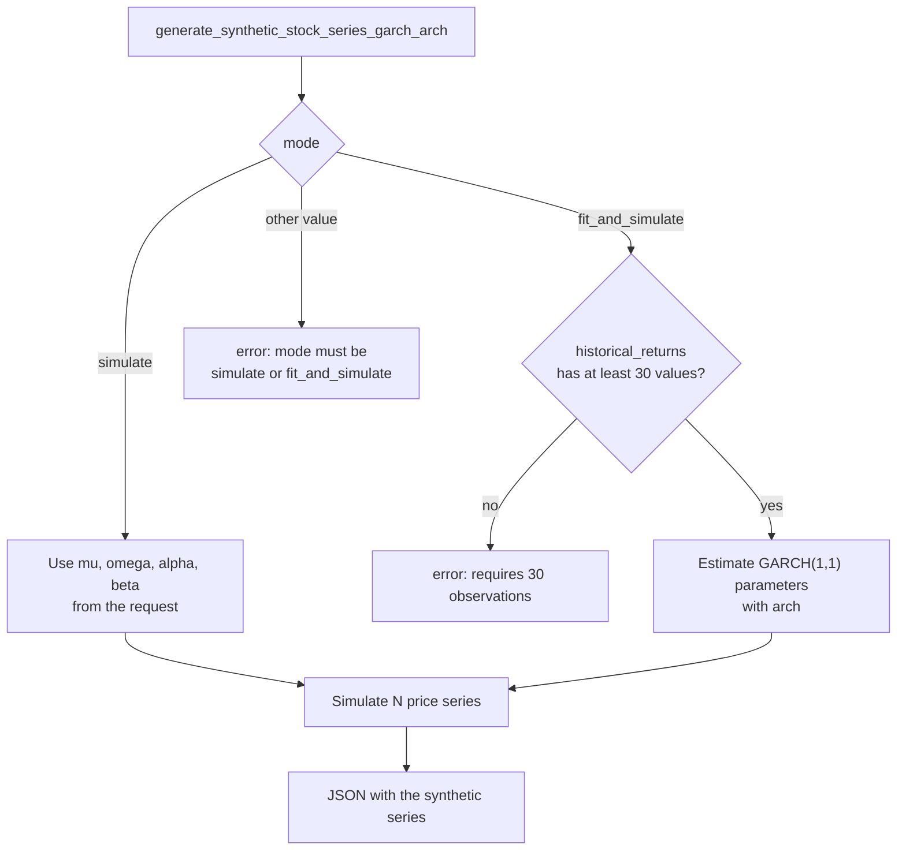
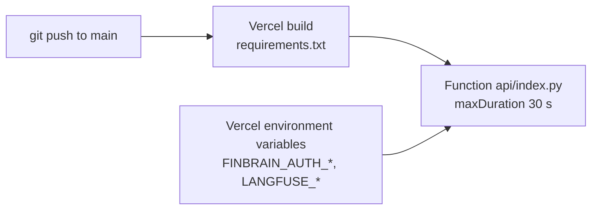

# FinBrain Simulate MCP

       

An **MCP (Model Context Protocol)** server that exposes the FinBrain tool for
simulating synthetic stock price series with a GARCH(1,1) model, using the
`arch` library.

It was split out of `finbrain-mcp` because the dependencies of this tool
(`arch`, with `scipy` and `statsmodels`) do not fit in the Vercel deployment.

## Contents

- [Overview](#overview)
- [Tools](#tools)
- [Modes](#modes)
- [Authentication](#authentication)
- [API documentation](#api-documentation-swagger)
- [Environment variables](#environment-variables)
- [Running locally](#running-locally)
- [Testing](#testing)
- [Deployment](#deployment)
- [Repository layout](#repository-layout)

## Overview



## Tools

| Tool | What it does |
|---|---|
| `generate_synthetic_stock_series_garch_arch` | Generates N synthetic daily price series with a GARCH(1,1) model. Supports the `simulate` and `fit_and_simulate` modes. |

The parameters and return formats are documented in
[`skills/synthetic_series/tools.py`](skills/synthetic_series/tools.py).

## Modes



- `simulate`: uses the GARCH parameters given in the request (defaults
  included).
- `fit_and_simulate`: estimates the parameters from `historical_returns`
  (fractional daily returns, for example `0.01` means 1%) first. It needs at
  least 30 values.

## Authentication

Authentication works the same way as in `finbrain-server`. When
`FINBRAIN_AUTH_JWKS_URL` is set, every request to the `/mcp` endpoint must
include an RS256 access token issued by the auth_service, in the
`Authorization: Bearer <token>` header. The token is checked against the public
keys of the JWKS, including `iss`, `aud`, `typ=access` and its expiry.

- No token, or an invalid token: `401` with `{"code", "message"}`.
- auth_service unreachable: `503`.
- `/health`, `/docs`, `/openapi.json` and `/redoc` do not require a token.
  `/tools` and `/mcp` do.
- Without `FINBRAIN_AUTH_JWKS_URL`, the endpoint is open.

See [`auth.py`](auth.py).

## API documentation (Swagger)

Open `/docs` (Swagger UI) to see the server description, each tool parameter
with its limits, the `/mcp` operation with JSON-RPC examples (`initialize`,
`tools/list`, `tools/call`), and the JSON catalog at `/tools`. Use the
**Authorize** button to enter the Bearer token when authentication is enabled.
The code is in [`docs_api.py`](docs_api.py).

## Environment variables

Copy [`.env.example`](.env.example) to `.env`.

| Variable | Required | Description |
|---|---|---|
| `FINBRAIN_AUTH_JWKS_URL` | No | JWKS of the auth_service (for example `https://authservice-delta.vercel.app/.well-known/jwks.json`). Enables authentication. |
| `FINBRAIN_AUTH_JWT_ISSUER` | No | Expected `iss` (default `auth-service`). |
| `FINBRAIN_AUTH_JWT_AUDIENCE` | No | Expected `aud` (default `synapse-apps`). |
| `LANGFUSE_PUBLIC_KEY`, `LANGFUSE_SECRET_KEY`, `LANGFUSE_HOST` | No | Tracing of tool calls in Langfuse. |

## Running locally

With [uv](https://docs.astral.sh/uv/):

```bash
uv run --no-project --with-requirements requirements.txt uvicorn mcp_server:app --port 8000
```

MCP endpoint: `POST http://localhost:8000/mcp` (Streamable HTTP, JSON-RPC).

## Testing

```bash
uv run --no-project --with-requirements requirements-dev.txt python -m pytest -q
```

The tests make no network calls: tokens are signed with a test key, and the
JWKS is replaced by a fake client.

## Deployment

`api/index.py` exposes `app` to Vercel (see `vercel.json`). Set the environment
variables above in the Vercel project.



**Side effect:** the tool only reads and computes, and does not change any
external state, but every call uses CPU time in the function.

## Repository layout

| Path | Purpose |
|---|---|
| `mcp_server.py` | MCP server and tool registration |
| `auth.py` | JWT verification with the auth_service JWKS |
| `docs_api.py` | Swagger/OpenAPI documentation |
| `skills/synthetic_series/` | GARCH simulation tool (`tools.py`) |
| `api/index.py` | Vercel entry point |
| `tests/` | Unit tests (no network) |
